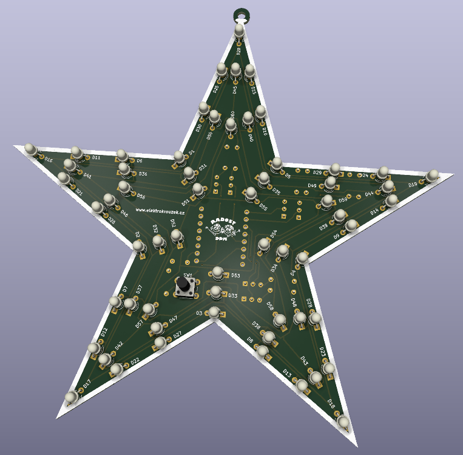

# Christmas star with ESP32
This is the construction of ESP32-C3 based Christmas star.

There are also code examples written in MicroPython.

PCB is 2-layer and was designed using KiCad 10. Fabrication output for JLCPCB is in 
gerber folder.

**Happy soldering!**

